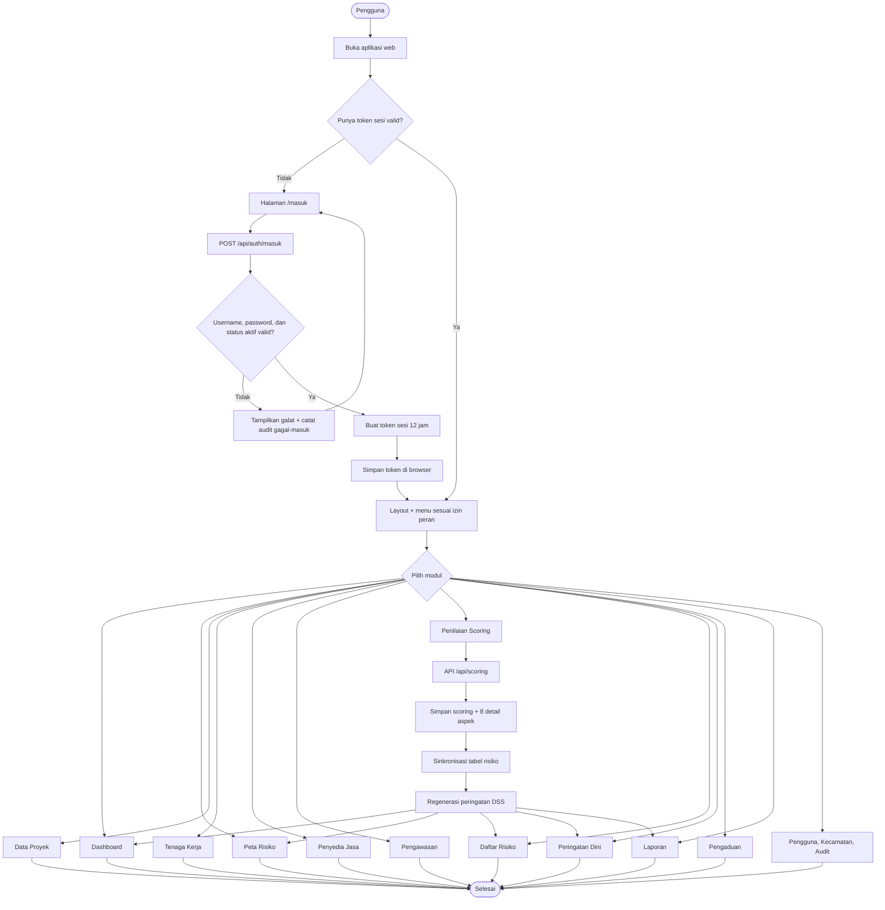
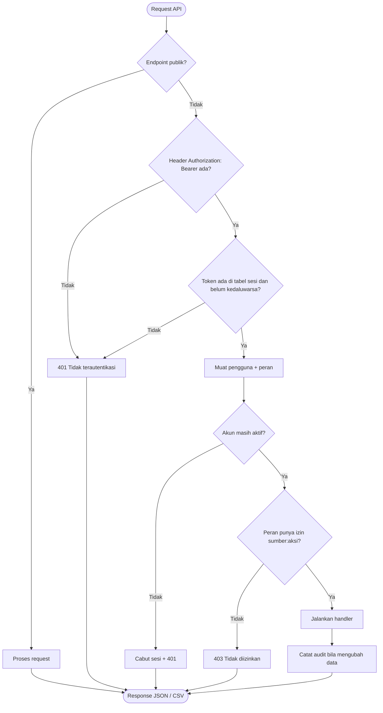
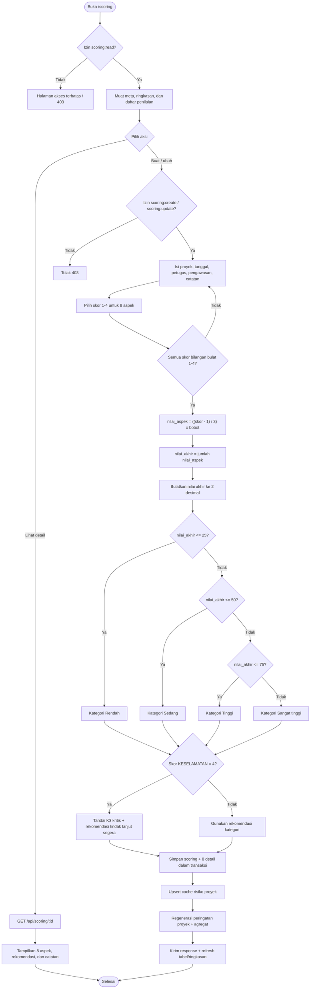
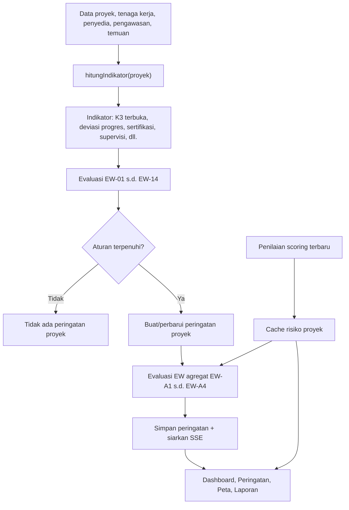
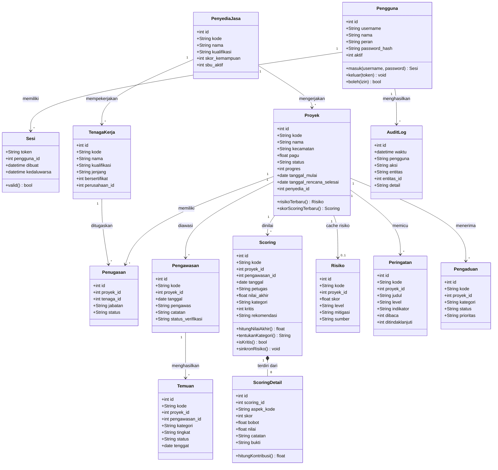
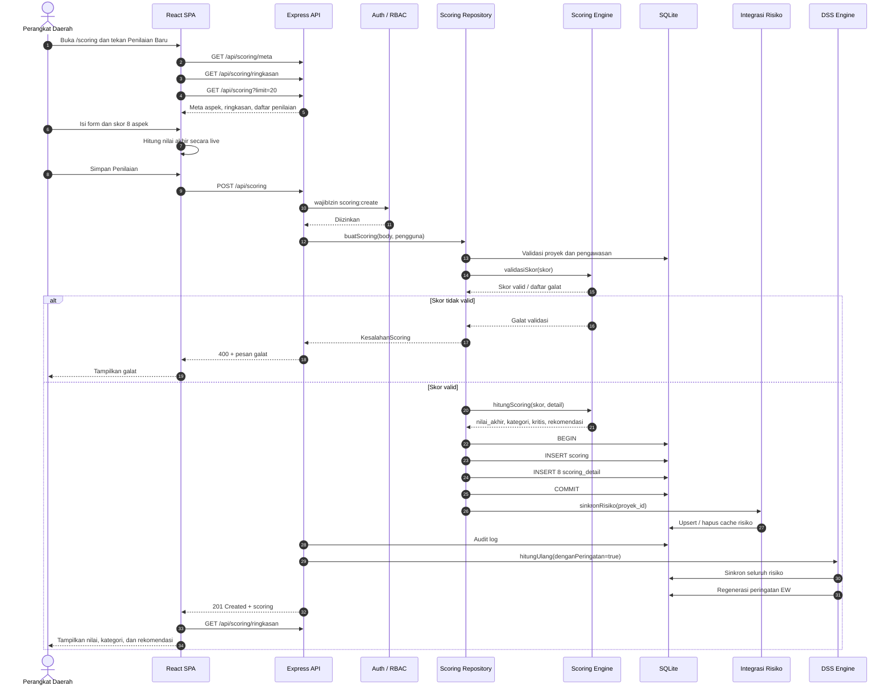
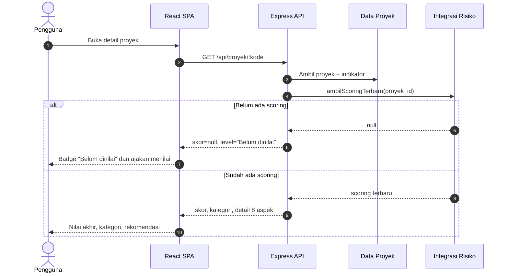
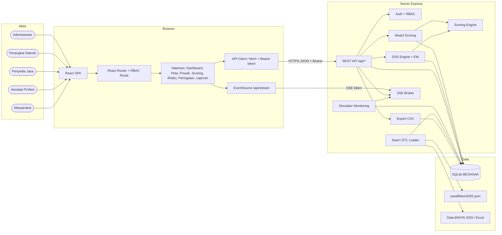
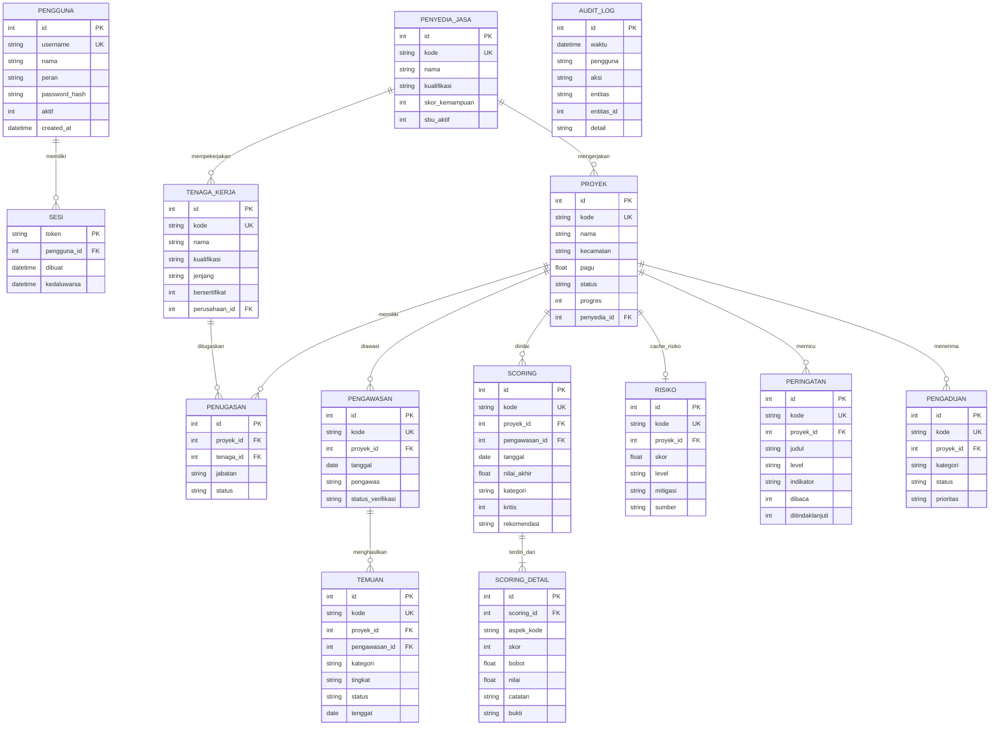

# Diagram Alur dan UML BEGASAK

Dokumen ini berisi flowchart dan diagram UML aplikasi **BEGASAK** dalam format
[Mermaid](https://mermaid.js.org/). Diagram dapat dirender langsung oleh GitHub,
GitLab, VS Code, Obsidian, atau Mermaid Live Editor.

## Daftar Diagram

1. [Flowchart utama aplikasi](#1-flowchart-utama-aplikasi)
2. [Flowchart autentikasi dan RBAC](#2-flowchart-autentikasi-dan-rbac)
3. [Flowchart penilaian scoring](#3-flowchart-penilaian-scoring)
4. [Flowchart DSS dan early warning](#4-flowchart-dss-dan-early-warning)
5. [UML use case](#5-uml-use-case)
6. [UML class diagram](#6-uml-class-diagram)
7. [UML sequence diagram](#7-uml-sequence-diagram)
8. [UML component diagram](#8-uml-component-diagram)
9. [ERD database](#9-erd-database)

---

## 1. Flowchart Utama Aplikasi

Alur umum dari pengguna membuka aplikasi sampai data scoring memengaruhi
dashboard, peta, risiko, peringatan, dan laporan.



---

## 2. Flowchart Autentikasi dan RBAC



Matriks izin utama:

| Modul | Administrator | Perangkat Daerah | Penyedia Jasa | Asosiasi Profesi | Masyarakat |
| --- | --- | --- | --- | --- | --- |
| Dashboard | Ya | Ya | Ya | Ya | Ya |
| Peta | Ya | Ya | - | Ya | - |
| Proyek | Ya | Ya | Baca/ubah | Baca | Baca |
| Tenaga kerja | Ya | Ya | Baca | Baca | - |
| Penyedia | Ya | Ya | Baca | Baca | - |
| Pengawasan | Ya | Ya | Baca | - | - |
| Scoring | Ya | Ya | Baca | Baca | Baca |
| Risiko | Ya | Ya | Baca | Baca | - |
| Peringatan | Ya | Ya | Baca | Baca | - |
| Pengaduan | Ya | Ya | Buat/baca | - | Buat/baca |
| Laporan | Ya | Ya | Ya | Ya | Ya |
| Pengguna | Ya | - | - | - | - |

---

## 3. Flowchart Penilaian Scoring

Alur ini adalah inti model risiko BEGASAK. Nilai akhir dihitung dari delapan
aspek, lalu dimaterialisasikan ke tabel `risiko`.



Bobot aspek:

| Kode aspek | Bobot |
| --- | ---: |
| `ADMINISTRASI` | 10 |
| `KEMAJUAN_FISIK` | 20 |
| `MUTU` | 20 |
| `WAKTU` | 15 |
| `KEUANGAN` | 10 |
| `KESELAMATAN` | 10 |
| `LINGKUNGAN` | 5 |
| `DOKUMENTASI` | 10 |

Rumus:

```text
nilai_aspek = ((skor - 1) / 3) x bobot
nilai_akhir = jumlah seluruh nilai_aspek
```

Klasifikasi:

| Rentang nilai | Kategori |
| --- | --- |
| 0 - 25 | Rendah |
| > 25 - 50 | Sedang |
| > 50 - 75 | Tinggi |
| > 75 - 100 | Sangat tinggi |

---

## 4. Flowchart DSS dan Early Warning

Risiko proyek berasal dari scoring terbaru, sedangkan indikator operasional
tetap dipakai untuk aturan early warning.



Prinsip penting:

- `scoring` adalah sumber kebenaran risiko.
- `risiko` hanya cache untuk Dashboard, Peta, Proyek, dan Laporan.
- Proyek tanpa scoring berstatus **Belum dinilai**, bukan risiko nol.
- Peringatan dini tetap memakai `hitungIndikator`, terpisah dari skor risiko.
- Skor `KESELAMATAN = 4` selalu menghasilkan penandaan K3 kritis.

---

## 5. UML Use Case

Mermaid belum memiliki notasi use-case native, sehingga diagram berikut
menggunakan aktor dan use case dalam bentuk flowchart UML.

```mermaid
flowchart LR
    Admin(["Administrator"])
    PD(["Perangkat Daerah"])
    Penyedia(["Penyedia Jasa"])
    Asosiasi(["Asosiasi Profesi"])
    Masyarakat(["Masyarakat"])

    subgraph SISTEM["Sistem BEGASAK"]
        UC1(("Masuk / keluar"))
        UC2(("Melihat dashboard"))
        UC3(("Melihat peta risiko"))
        UC4(("Mengelola data proyek"))
        UC5(("Mengelola tenaga kerja"))
        UC6(("Mengelola penyedia jasa"))
        UC7(("Mencatat pengawasan dan temuan"))
        UC8(("Membuat / mengubah scoring"))
        UC9(("Melihat scoring dan rekomendasi"))
        UC10(("Melihat daftar risiko"))
        UC11(("Menindaklanjuti peringatan dini"))
        UC12(("Mengirim / menangani pengaduan"))
        UC13(("Melihat dan mengekspor laporan"))
        UC14(("Mengelola pengguna dan audit"))
        UC15(("Mengelola kecamatan"))
    end

    Admin --> UC1
    Admin --> UC2
    Admin --> UC3
    Admin --> UC4
    Admin --> UC5
    Admin --> UC6
    Admin --> UC7
    Admin --> UC8
    Admin --> UC9
    Admin --> UC10
    Admin --> UC11
    Admin --> UC12
    Admin --> UC13
    Admin --> UC14
    Admin --> UC15

    PD --> UC1
    PD --> UC2
    PD --> UC3
    PD --> UC4
    PD --> UC5
    PD --> UC6
    PD --> UC7
    PD --> UC8
    PD --> UC9
    PD --> UC10
    PD --> UC11
    PD --> UC12
    PD --> UC13
    PD --> UC15

    Penyedia --> UC1
    Penyedia --> UC2
    Penyedia --> UC4
    Penyedia --> UC5
    Penyedia --> UC6
    Penyedia --> UC7
    Penyedia --> UC9
    Penyedia --> UC10
    Penyedia --> UC11
    Penyedia --> UC12
    Penyedia --> UC13

    Asosiasi --> UC1
    Asosiasi --> UC2
    Asosiasi --> UC3
    Asosiasi --> UC4
    Asosiasi --> UC5
    Asosiasi --> UC6
    Asosiasi --> UC9
    Asosiasi --> UC10
    Asosiasi --> UC11
    Asosiasi --> UC13

    Masyarakat --> UC1
    Masyarakat --> UC2
    Masyarakat --> UC4
    Masyarakat --> UC9
    Masyarakat --> UC12
    Masyarakat --> UC13
```



---

## 6. UML Class Diagram



Catatan: tabel `risiko` bukan sumber kebenaran. Nilai `skor` dan `level` di
dalamnya merupakan hasil sinkronisasi dari `Scoring` terbaru.

---

## 7. UML Sequence Diagram

Skenario: Perangkat Daerah membuat penilaian scoring baru.



Skenario membaca proyek yang belum dinilai:



---

## 8. UML Component Diagram



---

## 9. ERD Database

Entity Relationship Diagram utama. Kolom yang ditampilkan adalah kolom kunci
dan kolom penting; tabel lengkap dapat dilihat di `server/src/db.js`.



---

## Ringkasan Arsitektur

| Lapisan | Teknologi | Tanggung jawab |
| --- | --- | --- |
| Antarmuka | React 18 + Vite + Tailwind | Halaman, form, filter, grafik, peta, RBAC route |
| API | Express + better-sqlite3 | REST JSON, autentikasi, otorisasi, validasi, audit |
| Domain risiko | Scoring Engine + DSS Engine | Formula 8 aspek, klasifikasi, cache risiko, early warning |
| Realtime | Server-Sent Events | Monitoring, peringatan baru, hitung ulang DSS |
| Penyimpanan | SQLite mode WAL | Data proyek, tenaga, penyedia, pengawasan, scoring, peringatan |
| Data awal | Seed + ETL Python | Impor Data BIKON 2025 dan pembuatan data demonstrasi |
